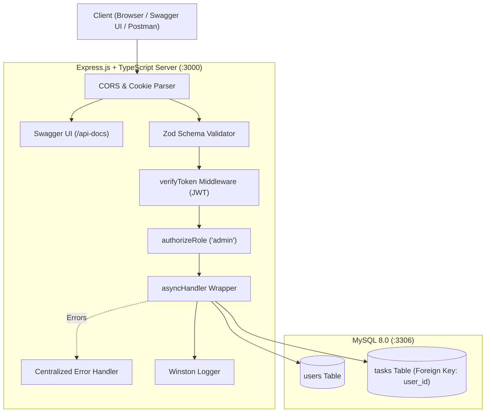

# 📋 Full-Stack Todo & Task Management System

[](https://www.typescriptlang.org/)
[](https://nodejs.org/)
[](https://expressjs.com/)
[](https://www.mysql.com/)
[](http://localhost:3000/api-docs)
[](https://www.docker.com/)
[](https://zod.dev/)

A production-ready Full-Stack Todo and Authentication system built with **Node.js, Express, TypeScript, and MySQL**. Features **JWT authentication with httpOnly cookie refresh rotation**, **Role-Based Access Control (RBAC)**, **Zod schema validation**, **centralized error handling**, **Winston structured logging**, **Docker containerization**, and interactive **Swagger (OpenAPI 3.0)** documentation.

---

## 📑 Table of Contents
- [Key Features](#-key-features)
- [System Architecture](#-system-architecture)
- [Tech Stack](#-tech-stack)
- [API Documentation (Swagger UI)](#-api-documentation-swagger-ui)
- [API Reference](#-api-reference)
- [Security & Engineering Practices](#-security--engineering-practices)
- [Database Schema](#-database-schema)
- [Getting Started](#-getting-started)
  - [Option A: Docker Compose (Recommended)](#option-a-docker-compose-recommended)
  - [Option B: Local Development Setup](#option-b-local-development-setup)
- [Environment Variables](#-environment-variables)
- [Project Structure](#-project-structure)
- [Author](#-author)

---

## 🌟 Key Features

* **Dual-Token Authentication Flow**:
  * Short-lived **JWT Access Tokens** passed via `Authorization: Bearer <token>` headers.
  * Long-lived **Refresh Tokens** stored securely in browser `httpOnly`, `SameSite` cookies to mitigate XSS and token-theft attacks.
* **Role-Based Access Control (RBAC)**:
  * Strict route guards isolating normal users from privileged administrative endpoints (e.g., `/auth/admin`).
* **Advanced Todo Management (CRUD)**:
  * Paginated task retrieval with query limits and page controls.
  * Search by keyword, filter by category (`Work`, `Personal`, etc.) and status (`pending`, `in-progress`, `completed`).
  * Multi-column sorting (`created_at`, `status`, `category`) with `ASC`/`DESC` ordering.
  * Strict user-scoping: users can only view, modify, or delete their own tasks.
* **Resilient Architecture**:
  * **Zod** request validation middleware validating route payloads before reaching business logic.
  * Centralized async error-handling middleware (`AppError`) preventing process crashes and masking internal stack traces.
  * **Winston** structured logging writing to both console and persisted log files (`combined.log`, `error.log`).
* **Interactive API Documentation**:
  * Embedded **OpenAPI 3.0** specification generated via `swagger-jsdoc` and rendered through **Swagger UI** at `/api-docs`.
* **Zero-Config Containerization**:
  * Multi-container setup with `docker-compose.yaml` orchestrating Node.js and MySQL 8 with automatic schema initialization.

---

## 🏗 System Architecture



---

## 🛠 Tech Stack

### Backend
* **Runtime**: [Node.js (v20+)](https://nodejs.org/) with [TypeScript](https://www.typescriptlang.org/) (executed via `tsx`)
* **Framework**: [Express.js 5](https://expressjs.com/)
* **Database**: [MySQL 8.0](https://www.mysql.com/) via [`mysql2/promise`](https://www.npmjs.com/package/mysql2) with prepared statements
* **Authentication**: [JSON Web Tokens (`jsonwebtoken`)](https://www.npmjs.com/package/jsonwebtoken) & [bcryptjs](https://www.npmjs.com/package/bcryptjs)
* **Validation**: [Zod](https://zod.dev/)
* **Documentation**: [Swagger UI Express](https://www.npmjs.com/package/swagger-ui-express) & [swagger-jsdoc](https://www.npmjs.com/package/swagger-jsdoc) (OpenAPI 3.0)
* **Logging**: [Winston](https://www.npmjs.com/package/winston)
* **DevOps**: Docker, Docker Compose

### Frontend
* **UI**: HTML5, Modern CSS3, Vanilla JavaScript (ES6+ Modules)
* **Features**: Live task dashboard, interactive modal dialogs, status badges, JWT token persistence.

---

## 📖 API Documentation (Swagger UI)

Interactive API documentation is integrated directly into the running application. You can explore request schemas, parameters, and execute live queries using the embedded **Swagger UI**.

* **Local URL**: `http://localhost:3000/api-docs`
* **Specification**: OpenAPI 3.0
* **Testing Auth Endpoints**: Click the **Authorize** button at the top of the UI and paste your JWT (`Bearer <token>`).

---

## 📡 API Reference

### 🔐 Authentication Routes (`/auth`)

| Method | Endpoint | Access | Description |
| :--- | :--- | :--- | :--- |
| `POST` | `/auth/register` | Public | Register a new user with username, email, and password. |
| `POST` | `/auth/login` | Public | Authenticate user; returns access token and sets `httpOnly` refresh cookie. |
| `POST` | `/auth/refresh` | Public (Cookie) | Issues a new access token using the `refresh_token` cookie. |
| `POST` | `/auth/logout` | Authenticated | Clears the refresh token cookie and invalidates session. |
| `GET` | `/auth/admin` | Admin Only | Administrative endpoint returning a list of all registered users. |

### 📝 Task Management Routes (`/todo`)

All `/todo` endpoints require the `Authorization: Bearer <access_token>` header.

| Method | Endpoint | Description | Query / Body Parameters |
| :--- | :--- | :--- | :--- |
| `GET` | `/todo` | Get user's todos (paginated) | `page`, `limit`, `search`, `category`, `status`, `sortBy`, `sortOrder` |
| `POST` | `/todo` | Create a new task | Body: `{ task, category, status? }` |
| `PUT` | `/todo/:id` | Update an existing task | Body: `{ task?, category?, status? }` |
| `DELETE` | `/todo/:id` | Delete a task by ID | Path parameter: `id` |

### 🩺 System & User Routes

| Method | Endpoint | Access | Description |
| :--- | :--- | :--- | :--- |
| `GET` | `/health` | Public | Healthcheck endpoint (`{ "status": "ok" }`). |
| `GET` | `/user` | Authenticated | Validates token and returns current user info. |
| `GET` | `/api-docs` | Public | Interactive Swagger UI API documentation. |

---

## 🔒 Security & Engineering Practices

1. **SQL Injection Defense**: All database queries utilize parameterized SQL statements via `mysql2/promise` (no dynamic string interpolation).
2. **Password Hashing**: Passwords are salted and hashed using `bcrypt` (12 rounds) before storage.
3. **Cookie Security**: Refresh tokens are stored using `httpOnly: true`, `sameSite: 'strict'`, and `secure: true` (in production) to prevent access by malicious JavaScript.
4. **Input Sanitization**: Request bodies, route parameters, and query strings are validated through strict **Zod schemas** before reaching handlers.
5. **Centralized Error Handling**: Custom `AppError` class standardizes operational errors versus programming errors, returning consistent JSON responses:
   ```json
   {
     "success": false,
     "error": "Task not found",
     "statusCode": 404
   }
   ```
6. **Graceful Logging**: Errors and system events are logged via Winston with timestamps and stack traces into persistent log files.

---

## 🗄 Database Schema

The database initializes automatically when running through Docker Compose using `backend/db/init.sql`.

```sql
CREATE TABLE IF NOT EXISTS users (
  id INT AUTO_INCREMENT PRIMARY KEY,
  username VARCHAR(50) NOT NULL,
  email VARCHAR(100) UNIQUE NOT NULL,
  password VARCHAR(255) NOT NULL,
  role VARCHAR(20) DEFAULT 'user',
  created_at TIMESTAMP DEFAULT CURRENT_TIMESTAMP
);

CREATE TABLE IF NOT EXISTS tasks (
  id INT AUTO_INCREMENT PRIMARY KEY,
  task VARCHAR(255) NOT NULL,
  category VARCHAR(100),
  status VARCHAR(50) DEFAULT 'pending',
  user_id INT NOT NULL,
  created_at TIMESTAMP DEFAULT CURRENT_TIMESTAMP,
  FOREIGN KEY (user_id) REFERENCES users(id) ON DELETE CASCADE
);
```

---

## 🚀 Getting Started

### Option A: Docker Compose (Recommended)

Run the entire stack (Node.js API + MySQL database) with a single command:

```bash
# 1. Clone the repository
git clone https://github.com/Akash0086/ToDo-App.git
cd ToDo-App

# 2. Build and start containers
docker compose up --build
```

* Backend API: `http://localhost:3000`
* Swagger UI Docs: `http://localhost:3000/api-docs`
* MySQL Database: `localhost:3307` (Mapped from container port 3306)

---

### Option B: Local Development Setup

#### 1. Prerequisites
* Node.js v18+ or v20+
* MySQL Server running locally

#### 2. Install Dependencies
```bash
cd backend
npm install
```

#### 3. Setup Environment Variables
Copy `.env.example` to `.env`:
```bash
cp .env.example .env
```
Update the `.env` values to match your local MySQL credentials.

#### 4. Initialize Database
Execute `backend/db/init.sql` in your MySQL database client (MySQL Workbench, TablePlus, or CLI) to create the `todo` database and necessary tables.

#### 5. Start Development Server
```bash
npm run dev
```
The server will start on `http://localhost:3000`.

#### 6. Open Frontend
Open `frontend/index.html` in your web browser (or use VS Code Live Server).

---

## ⚙ Environment Variables

Configure the following variables inside `backend/.env`:

| Variable | Description | Example / Default |
| :--- | :--- | :--- |
| `PORT` | Port the Express server listens on | `3000` |
| `NODE_ENV` | Application environment (`development` / `production`) | `development` |
| `DB_HOST` | MySQL database host | `localhost` (or `mysql` in Docker) |
| `DB_USER` | MySQL username | `root` |
| `DB_PASSWORD` | MySQL password | `your_password` |
| `DB_NAME` | MySQL database name | `todo` |
| `ACCESS_TOKEN` | Secret key for signing short-lived JWT access tokens | `your_access_token_secret` |
| `REFRESH_TOKEN`| Secret key for signing refresh tokens | `your_refresh_token_secret` |
| `SALT_ROUNDS` | Salt rounds for bcrypt password hashing | `12` |

---

## 📂 Project Structure

```text
todoWeb/
├── docker-compose.yaml         # Multi-container orchestration (App + MySQL)
├── README.md                   # Comprehensive project documentation
├── .gitignore                  # Git ignore rules for secrets and build artifacts
├── logs/                       # Application logs (combined.log, error.log)
├── backend/
│   ├── .env.example            # Template for environment configuration
│   ├── dockerfile              # Multi-stage container definition
│   ├── package.json            # Node.js dependencies and scripts
│   ├── server.ts               # Express application entry point & middleware mounting
│   ├── router.ts               # Todo CRUD routes with Swagger JSDoc annotations
│   ├── swagger.ts              # OpenAPI 3.0 specification & schema registry
│   ├── auth/                   # Authentication controllers (login, register)
│   ├── db/
│   │   ├── connection.ts       # MySQL2 connection pool setup
│   │   └── init.sql            # Database DDL initialization script
│   ├── middleware/
│   │   ├── asyncHandler.ts     # Wrapper for catching unhandled promise rejections
│   │   ├── authorizeRole.ts    # RBAC route guard middleware
│   │   ├── errorHandling.ts    # Centralized HTTP error-handling middleware
│   │   ├── validation.ts       # Generic schema validation runner
│   │   └── validationSchema/   # Zod validation schemas
│   ├── models/                 # TypeScript interfaces and DTO definitions
│   ├── routes/                 # Specialized sub-routers (admin, token refresh)
│   └── utils/                  # Utility helpers (bcrypt, jwt, logger, AppError)
└── frontend/
    ├── index.html              # Main landing / task management dashboard
    ├── pages/                  # Additional views (login, signup, dashboard)
    ├── scripts/                # Frontend API consumers and DOM controllers
    ├── services/               # API service abstractions
    └── style/                  # CSS stylesheets
```

---

## 👤 Author

* **Akash**
* GitHub: [@Akash0086](https://github.com/Akash0086)
